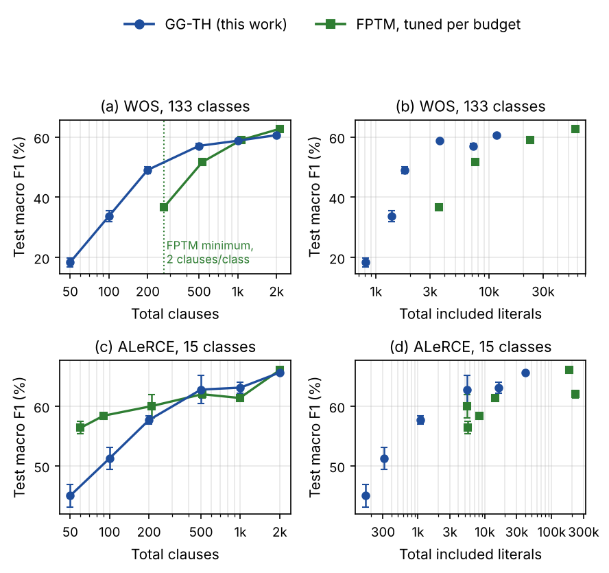

# GG-TH: Gradient-Guided Tsetlin Machines with a Ternary Hidden Readout

Code, run logs and analysis for the paper

> **Gradient-Guided Tsetlin Machines with a Ternary Hidden Readout for Many-Class Classification under Tight Clause Budgets**
> L. Yavits *et al.*, submitted to *Expert Systems with Applications*, 2026.

GG-TH is a Tsetlin Machine (TM) in which a **shared clause pool** reaches the classes through a jointly trained **ternary hidden layer** and a ternary output layer. Clauses are trained by **gradient-guided (GG) feedback**:

- For each sample and clause, compute the gradient of the readout's log-likelihood with respect to the clause output, $g_j = \partial \log p_y / \partial c_j$.
- The sign of $g_j$ selects Type I ($g_j>0$) or Type II ($g_j<0$) feedback.
- The clause is selected with probability $\pi_j=(1-p_y)\min(1,|g_j|/\bar g)$.

Inference uses only clause evaluation, signed popcounts, two integer thresholds per hidden unit and an argmax. It needs no multiplications. The clause count is independent of the class count.

## Main results

All values are test macro F1 in %, mean over 3 seeds. The full tables are in [`results/summary.md`](results/summary.md).

**WOS (133 classes), against FPTM tuned per budget:**

| GG-TH clauses | GG-TH macro F1 | FPTM clauses | FPTM macro F1 | Δ (p) |
|---|---|---|---|---|
| 200 | 49.09 | 266 (FPTM minimum) | 36.61 | +12.49 (0.001) |
| 500 | 57.07 | 532 | 51.74 | +5.34 (0.001) |
| 1000 | 58.78 | 1064 | 59.04 | −0.26 (0.46) |
| 2000 | 60.64 | 2128 | 62.75 | −2.11 (0.010) |

**ALeRCE (15 classes):** no significant difference from about 200 to 2000 clauses. FPTM is stronger at 50 and 100 clauses.

**Ablation at 1000 clauses:** GG feedback adds 13.1 pp (WOS) and 3.1 pp (ALeRCE) over CoTM-style training. The ternary hidden layer adds a further 4.0 and 3.3 pp.



## Repository layout

```
ggth/tm.py                 clause bank, CoTM readout, GG-linear and GG-TH readouts
ggth/data.py               prepared splits, class-balanced sampling, metrics
train.py                   single training run (one JSON log per run, one record per epoch)
fptm/fptm_run.jl           driver for the unmodified FPTM reference implementation (baseline)
fptm/export_bin.py         exports the splits to raw binaries for the Julia driver
experiments/config.py      datasets, budgets, search grids, result paths, selection rules
experiments/run.py         ablation, tuning and final runs (skips completed runs)
analysis/report.py         tables (results/summary.md) and figure (figures/fig_budget.pdf)
results/                   all run logs used in the paper (ablation, tuning, final)
tests/check_reproduction.py  bit-exact check of three stored runs
```

## Installation

```bash
git clone https://github.com/leonid-yavits/gradient-guided-TM.git && cd gradient-guided-TM
python -m pip install -r requirements.txt   # tested with Python 3.13, NumPy 2.5, SciPy 1.18, Matplotlib 3.11
```

**For the FPTM baseline only:**
- Julia (tested with 1.13).
- The FPTM reference implementation, pinned to the commit used in the paper:

```bash
git clone https://github.com/BooBSD/FuzzyPatternTM fptm/FuzzyPatternTM
git -C fptm/FuzzyPatternTM checkout e25a51e1ad6778f503f8725b9d98b60b4904e68b
```

## Data

The experiments use the prepared TreeTM splits of two public datasets:
- **WOS:** Web of Science WOS-46985, Kowsari *et al.*, ICMLA 2017, Mendeley Data, DOI 10.17632/9rw3vkcfy4.6.
- **ALeRCE:** the ALeRCE light-curve classifier labeled set, Sánchez-Sáez *et al.*, AJ 2021, Zenodo, DOI 10.5281/zenodo.4279623.

See [`data/README.md`](data/README.md) for how to obtain them. Place them as `data/TreeTM_datasets/{wos,alerce}/{prepared.npz,meta.json}`, or point `GGTH_DATA` to their location.

## Reproducing the paper

```bash
python tests/check_reproduction.py            # about 1 min: bit-exact match with stored logs
python analysis/report.py                     # tables and figure from the stored logs (no training)

# Full re-run. Each phase skips runs whose log already exists, so move results/ aside to start fresh.
python fptm/export_bin.py wos alerce          # binaries for the Julia driver (data/bin)
python experiments/run.py ablation --workers 2
python experiments/run.py tune     --workers 2
python experiments/run.py final    --workers 2
python analysis/report.py
```

**Protocol:**
- **Sampling:** each epoch draws P samples per class, with P = 300 for WOS and 4000 for ALeRCE.
- **Selection:** hyperparameters are selected on validation macro F1 after 5 epochs with seed 1.
- **Reporting:** the final runs train for 20 epochs with seeds 1 to 3 and report test metrics after epoch 20. The test split is never used for selection.
- **Compute:** the full re-run takes several hours on two CPU cores. The GG-TH code is plain NumPy, single-threaded per run.

A single run:

```bash
python train.py --dataset wos --readout gg_hidtern --clauses 200 --s 10 --lr 3e-3 --H 256 --P 300 --epochs 20 --seed 1 --out run.json
```

## Citation

```bibtex
@unpublished{yavits2026ggth,
  title  = {Gradient-Guided {T}setlin Machines with a Ternary Hidden Readout for Many-Class Classification under Tight Clause Budgets},
  author = {Yavits, Leonid},
  note   = {Submitted to Expert Systems with Applications. Code: https://github.com/leonid-yavits/gradient-guided-TM},
  year   = {2026}
}
```

## License

Code: MIT (see [`LICENSE`](LICENSE)). The FPTM reference implementation is not included. It is MIT-licensed by its author and is fetched separately. The datasets keep their original licenses.
